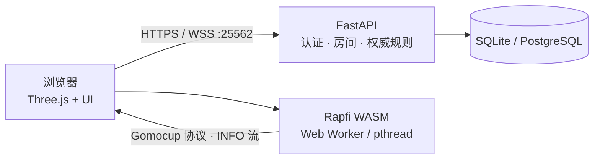

# 弈境 · Yijing Gomoku


一个原创的 3D 禅意网页五子棋：木纹棋盘、黑白高光棋子、柔和光影、程序化音效，支持本地对弈、AI 对弈和好友联机。前端使用 Vite + TypeScript + Three.js；AI 由 **Rapfi 引擎的 WASM 构建**直接在浏览器里运行（实时思考信息可视化），后端使用 FastAPI 负责认证、房间与权威规则。

项目使用 Poly Haven 的 CC0 素材（HDRI 环境光 / PBR 材质 / 扫描模型）构建真实场景，棋盘与棋子仍为程序化生成；音效由 Web Audio 合成，UI 为原创设计。第三方素材授权见 THIRD_PARTY_NOTICES.md。

> **开发说明**：本项目完全由 AI 模型 **DeepSeek V4.1 Flash 1017** 完成——包括前端与后端代码、3D 棋境与棋子、UI、音效、测试与文档。

## 功能

- 15 × 15、黑先、无禁手、连续五子及以上获胜、满盘平局
- 本地同屏对弈，无需服务器
- 游客或注册账号登录；密码使用 Argon2id 哈希
- 单机对弈 Rapfi（Gomocup 顶尖引擎，浏览器端 WASM），可选择执黑或执白
- 在线大厅：实时在线名单，标注「可约战 / 房间等待中 / 对弈中」
- 点击大厅里的棋友发起约战，对方 30 秒内接受即开局
- **开局决定先后手**：联机对局每局开始前，两位玩家各自独立选择「希望谁先手」
  （选自己或选对方）；两人指向同一位玩家则该玩家先手、直接开局，指向不同玩家
  则进入 3D 抛硬币环节随机决定——硬币两面分别刻着两位玩家的名字，落地朝上的
  一面先手。揭晓前谁也不能落子；联机「再来一局」同样重新走一遍流程
  （AI 对局与本地同屏沿用传统的黑先规则）
- 创建房间、6 位房间号加入、实时同步落子
- 刷新页面/断线后通过 Cookie 和棋谱恢复对局
- 单机悔棋撤销一轮；联机悔棋需对方确认
- 认输、重开、最后落子标记、胜负连线标记
- 观战：大厅里对弈中 / 观战中的人可以点「观战」，第三人只读地看同一张棋盘（好友联机与人机对局均可），结束时留在原地看结果；正在观战的人在大厅名单里单独标为「观战中」
- **对局内 AI 分析**：好友联机对局里点操作坞的「AI分析」，对方同意后由请求方的本地引擎计算建议一手（棋盘上亮出提示环）；婉拒则提示请求未通过
- **手动 AI 分析（人机 / 本地对弈）**：对局进行中点操作坞的「AI分析」，本地 Rapfi 引擎直接分析当前局面，弹出建议落子并在棋盘亮提示环，状态栏同步显示实时思考信息；全程浏览器本地计算，零服务端参与
- **实时思考面板**：人机对局中 AI 思考时，状态栏实时显示搜索深度、胜率、评估分与主变化（Rapfi 原生 INFO 流，浏览器本地直读，零延迟）
- 对手断线会亮出横幅并开始倒计时，两分钟不回来自动判负（`winReason: offline`）
- 桌面上一枚铜铃，联机时按一下可以催促对手；对手的提示音与铃声同步响
- 五种棋境：基础茶室、日式庭院、赛博夜局、现代客厅、摄影棚；本地 / 建房 / 开 AI 局时都可手选，也可以交给开局随机
- 网络电台：服务器统一排期，所有人在同一首歌的同一位置，只有静音与音量两个控制
- 悬停半透明棋子、落子缩放/涟漪、柔和程序化音效、静音
- 鼠标与触屏落子，响应式桌面/手机布局，支持减少动画偏好
- **对局复盘**：已经下完的 AI / 联机棋局留在服务器上，可按「全部 / 与好友 / 与 AI」分类查看，首页「复盘 · 近期对局」随时翻出来一手一手回看（首手 / 上一手 / 播放 / 下一手 / 终局 + 进度条），结算卡上也有「复盘本局」直接进入。播放条上写明这一局的**日期时间**与结果，左侧是实心的「返回」按钮（按 Esc 同样可以退出），进入时还会提示一次怎么退出。复盘期间被棋友约战，接受后会直接收掉复盘、进入新对局（不会被卡在回放里）。复盘复用同一套棋盘渲染，落子动画、最后一手标记、五连高亮都与实战一致
- **手数编号 + 设置界面**：顶栏齿轮打开设置，可选择棋子上「不显示 / 最新一步 / 最新两步 / 全部步数」四种编号方式，黑子配浅字、白子配深字，**最新一手标红**（黑子亮红、白子暗红），对局、复盘、刷新页面之后都保持一致；偏好存在本地，只影响自己看到的画面。编号开启时最新一手的提示圆点自动隐藏，两者互斥；圆点做成「靶心」双环，并等落子动画结束后才亮出，在半透明白子上也清晰可辨
- **特殊棋子材质**：除默认黑白实体棋子外，可在商城解锁「磨砂半透明黑」「半透明白」两种玻璃 / 磨砂质感材质（`MeshPhysicalMaterial` 的透射 + 磨砂 + 釉光），并在对局中实时切换；未解锁 / 未装备绝不渲染
- **积分与商城**：每局结束发放固定积分（每局 10 分，新档案初始 500 分），积分用于解锁特殊材质与棋境（日式庭院 / 赛博夜局 / 现代客厅），可装备或切换；积分与「已解锁 / 已装备」状态存于本地 `localStorage`，刷新保留、无需登录
- **快捷短语**：操作坞内的「短语」按钮（与重开 / 悔棋 / 认输 / 退出同一枚胶囊），点击展开预设短语，点击经 WebSocket 广播给对方并弹出气泡；文案由服务端按 `phraseId` 下发规范文本，从源头杜绝 chat 注入
- **桌面铜铃支持连点**：连续点击每次都播放下压与声波动画并各自发一次 `game.ring`；服务端 2.5 秒冷却只控转发，不再在前端拦截连按
- **结算卡可点棋盘空白临时收起**：局终弹出的结算卡，点击棋盘空白处可临时隐藏、再点一次恢复，方便终局后旋转 / 缩放观察棋盘；收起期间拖拽、缩放不会重新唤起结算卡
- **复位视角带平滑过渡**：点「复位视角」不再瞬切，相机的机位、朝向与视野会以缓动动画回到默认斜视角（即便系统开启「减少动态效果」也保留该过渡，因为复位属于主动视图导航）
- **中键一键复位视角**：对局中在棋盘上**单击鼠标中键**即可把视角平滑复回默认斜视角（与「复位视角」按钮同一套缓动动画）；中键拖拽（位移超阈值）不触发，避免与浏览器中键自动滚动冲突，右键拖拽旋转、滚轮缩放均不受影响

## 架构



关键原则：

1. **引擎跑在浏览器里。** AI 落子、思考可视化、复盘评估全部由前端 WASM 引擎完成，
   服务端零引擎进程；AI 着法经 `game.ai_move` 提交，服务端重新校验合法性。
2. **服务端是权威。** 回合、坐标、胜负、悔棋都由后端校验；前端只做即时反馈。
3. **无状态分析。** 引擎每次思考都 `START + BOARD` 全量重建，悔棋、重开、复盘天然兼容。
4. **多线程按能力降级。** COOP/COEP 就绪时用 pthread 变体（主线程实例化，重活在
   引擎自己的 pthread 里），否则退回单线程 SIMD 变体（Worker 包裹）。
5. **状态落库。** 游戏和每一手都持久化，刷新或后端重启后仍能恢复。
6. **大厅不落库。** 在线名单由连接表算出，约战是 30 秒有效期的内存握手——
   连接断了就作废，没有需要恢复的历史，也就不需要一张表去清理。

## 目录

```text
.
├─ frontend/
│  ├─ public/
│  │  ├─ hdri/        # 4 张 HDRI 环境贴图（lebombo 兜底 / 古民家 / 园林 / 外滩，CC0）
│  │  ├─ models/      # 6 个扫描 GLB 模型（茶具 / 盆栽 / 树木 / 岩石 / 石灯，CC0）
│  │  └─ textures/    # 7 套 PBR 贴图（榻榻米 / 杉木 / 红木 / 深木 / 白砂 / 钢板 / 棋盘，CC0）
│  ├─ src/
│  │  ├─ game/        # 规则、类型、本地对局状态、断线横幅的口径
│  │  ├─ engine/      # Rapfi WASM 客户端（能力探测 / Worker / 主线程 pthread 模式）
│  │  ├─ scene/       # 3D 场景（见下方「3D 场景结构」），含桌上的铜铃 Bell.ts
│  │  ├─ audio/       # Web Audio 程序化音效、网络电台播放器
│  │  ├─ network/     # WebSocket 客户端与重连
│  │  ├─ auth/        # 认证请求与 Cookie 会话
│  │  ├─ ui/          # 页面骨架、反馈、图标
│  │  ├─ shop/        # 积分商城与快捷短语数据层（store.ts / phrases.ts / store.test.ts）
│  │  ├─ utils/       # 请求 ID、剪贴板等浏览器兼容封装
│  │  └─ styles/
│  ├─ src/game/rules.test.ts
│  └─ vite.config.ts
├─ backend/
│  ├─ app/
│  │  ├─ game.py      # 权威对局、AI 着法接收与校验、悔棋、重开、铜铃与短语中继
│  │  ├─ lobby.py     # 在线大厅、座位状态、约战握手
│  │  ├─ spectate.py  # 观战：只读席位，内存登记，断线即退
│  │  ├─ radio.py     # 电台曲库（扫描目录 + 索引）
│  │  ├─ radio_routes.py  # /api/radio 列表与流式音频
│  │  ├─ hub.py       # 多连接管理与个性化快照广播
│  │  ├─ websocket.py # 消息分发、请求幂等
│  │  ├─ security.py  # Argon2id、会话令牌、限流
│  │  ├─ auth_routes.py
│  │  ├─ models.py    # SQLAlchemy 模型
│  │  ├─ rules.py     # 服务端规则，预留禁手策略
│  │  └─ main.py
│  ├─ tests/
│  ├─ requirements.txt
│  └─ Dockerfile      # 仅后端镜像（本地单独构建时使用）
├─ deploy/
│  ├─ Caddyfile
│  └─ nginx.conf
├─ engines/           # 只放说明，不提交引擎二进制
├─ radio/             # 电台曲库（放自己的音乐，不提交）
├─ Dockerfile         # 前端 + 后端多阶段生产镜像
├─ docker-compose.yml
└─ THIRD_PARTY_NOTICES.md
```

## 3D 场景结构

渲染层拆成三个互不依赖的模块，由一个薄门面串起来。**所有胜负判断、合法性校验都在
`game/rules.ts` 与服务端 `app/rules.py`，场景层只负责把已经算好的棋盘画出来**，
因此改视觉不会影响规则。

```text
frontend/src/scene/
├─ GomokuScene.ts       门面：指针事件、快照翻译、棋境装配，对外 API 保持不变
├─ SceneManager.ts      渲染器 / 相机 / OrbitControls / 后处理(Bloom) / 补间队列 / 主循环
├─ BoardManager.ts      棋盘、棋子、预览、标记、落子动画、射线拾取
├─ materials.ts         程序化兜底纹理（棋盘木纹占位 / 棋子光晕）+ 棋境辅助贴图
├─ stoneMaterials.ts   棋子材质目录 + 工厂（solid / frosted / translucent，透射玻璃质感）
├─ assets.ts            CC0 素材加载（HDRI / PBR 贴图 / glTF 模型，含 Meshopt 解码）
├─ config.ts            棋盘常量、相机机位、配色、坐标换算
├─ environments/
│  ├─ Environment.ts    基类：柱/障子/座布团建造工具 + 每环境 HDRI / Bloom 切换
│  ├─ TeaRoom.ts        基础茶室：榻榻米 + 古民家 HDRI + 真实茶具
│  ├─ Courtyard.ts      日式庭院：枯山水白砂 + 真实岩石 + 蓝花楹骨架
│  ├─ Cyberpunk.ts      赛博夜局：外滩夜景 HDRI + 发光网格 + 霓虹 + Bloom
│  ├─ LivingRoom.ts     现代客厅：CG 户型套件裁剪导入，棋盘落在茶几上
│  └─ Studio.ts         摄影棚：360° 弧形无缝背景 + 柔光箱面光 + 接触阴影
└─ animation/
   └─ tween.ts          自研 rAF 补间引擎（缓动函数 + 队列）
```

**为什么不用 gsap**：落子只需要「一段位移 + 一段缩放回弹」，自研约 100 行即可覆盖，
既省掉运行时依赖，也能把缓动函数抽成纯函数做单元测试（`tween.test.ts` 11 个用例）。

**界面布局**：3D 场景铺满整个视口（`position: fixed; inset: 0`），页面本身不滚动；
顶栏、叙事行、状态胶囊与操作坞都是浮在场景上的玻璃薄片，不再用外层卡片把棋盘框起来。
首页会通过 `#app.is-playing` 这个类把对局 HUD 淡出，并把顶栏文字切换成浅色——
因为对局中背景是深色木面，浅色文字才读得清。

**相机与操作**

| 操作 | 效果 |
| --- | --- |
| 左键点击 | 落子（左键拖拽被忽略，不会误放棋子） |
| 右键拖动 | 旋转视角 |
| 滚轮 / 双指捏合 | 缩放 |
| 触屏单指 | 落子（不触发旋转） |
| 触屏双指 | 旋转 + 缩放 |

极角限制在 `0.02 ~ 1.05 rad`：下限不为 0 是因为视线与 up 向量完全平行时 `lookAt` 会退化；
上限保证相机不会沉到桌面以下。**方位角完全放开**，房间四面墙与天花都做齐了，
玩家可以 360° 环绕观察棋局；缩放上限收在 56 单位以保证相机始终留在室内。

**取景是算出来的，不是写死的**：`SceneManager` 把棋盘八个角投影到 NDC，迭代调整相机距离，
直到包围盒正好填满「视口减去 HUD 占位」的安全区（`VIEW_INSETS`），再用
`camera.setViewOffset` 做一次纵向补偿——透视下棋盘近端被放大，包围盒并不以屏幕中心对称，
只按距离缩放会留下「上边空一块、下边贴边」的观感。竖屏另有一套更俯视的机位
（俯角 38.7° → 65°），因为方棋盘在竖屏里最多只能占到屏幕宽度那么多高度，
压低俯角只会让投影更扁、更浪费竖向空间。

**3D 场景（五种棋境）**

一局棋在哪个房间里下，由 `scene` 字段决定，就五个值：`tea / courtyard / cyber / living / studio`。五种棋境
共用同一套渲染层（`SceneManager` + `BoardManager` + `Environment` 基类），只在「材质与陈设」
上不同；真实感来自三类 CC0 素材（下载自 Poly Haven，见 `THIRD_PARTY_NOTICES.md` 与
`docs/SCENE_OPTIMIZATION.md`）：**HDRI 环境光与背景、PBR 材质贴图、扫描模型**。

- **基础茶室**（默认）：榻榻米（`tatami` 全套 PBR，带绿席边）、杉木梁柱与障子框（`cedar`）、
  红木桌面（`rosewood`）；古民家 HDRI（`studio_kominka_01`）作环境光；桌上摆真实扫描茶具（`tea_set_01`）。
- **日式庭院**：`chinese_garden` HDRI 直接作 360° 天空背景与天光来源；脚下枯山水换 `zensand`
  白砂 PBR；石组用真实扫描岩石（`coast_rocks_01` / `boulder_01`）；庭松（调松绿）与红枫
  （调枫红）共用 `jacaranda_tree` 骨架调色。
- **赛博夜局**：`shanghai_bund` 外滩夜景 HDRI 作背景；金属网格地面用 `metalplate` PBR；
  樱花树用 `jacaranda_tree` 骨架 + 粉色自发光；霓虹招牌为立地灯杆并闪烁；
  **仅此棋境开启 `UnrealBloom` 后处理**。
- **现代客厅**：整间导入的真实户型（用户提供的「CG美术之家」套件，**非 CC0**，由
  `tools/import_cg_gltf.py` 从 186 万面裁剪合成 27.7 万面 + 1K 贴图内嵌，17.9MB）；
  棋盘按真实比例落在茶几上（运行时按材质名找 `Coffee_Table` 对位），沙发、电视、
  木地板与门洞保持真实动线；真实户型无全局光照，用半球光 + 日光 + 天花暖点光 +
  棋盘聚光补足。
- **摄影棚**：不讲故事，只做「静物产品照」。地面→圆角→背墙用一条 `LatheGeometry`
  剖面转成 **360° 无缝弧形背景**；三盏 `RectAreaLight` 当柔光箱（主光 / 补光 / 顶光，
  另加一盏轮廓光），面光源在漆面棋子与棋盘上打出成条的柔和反射。注意 three 0.180
  的面光**不支持阴影**，所以接触阴影交给一盏与主光同向的平行光；背景洗墙用宽角 +
  全半影聚光灯（面光打在墙上会是一块硬边矩形，反而像地平线）。桌面复用
  `buildTable` + `darkwood` 贴图，不新增模型。

素材文件已下载到 `public/` 随项目分发，运行时不访问外网。贴图与模型都是**异步加载后热替换**：
房间先以纯色建好，素材到位再挂上去，用户不会看到白屏等待。陈设刻意布置在棋盘两侧与后方，
绝不挡在棋盘正前方——对局取景时它们在画面外，只在开局推镜和缩远视角时出现。

**环境贴图（HDRI）**：`.hdr` 经 `PMREMGenerator` 预滤波后挂到 `scene.environment`，
原图同时可作 `scene.background` 当 360° 天空 / 夜景。这是整套场景真实感的最大来源——
地板打蜡的反光、棋子清漆的高光、桌面木蜡油的光泽都靠它拿到真实的环境反射，而不是只能
靠几盏灯的镜面高光。每个棋境用各自匹配的 HDRI（茶室古民家、庭院园林、赛博外滩），
默认 `lebombo_1k.hdr` 作兜底环境光。

**光照**：HDRI 环境贴图打底，加三盏灯。日光平行光从场景外斜射进来
（castShadow，阴影相机收紧到 ±62 单位），半球光 0.38 兜底，
再加一盏聚光灯专门补偿棋盘照度。
聚光灯仰角约 37°——棋子只有 0.36 高，若光源接近垂直，投影长度
`高度 / tan(仰角)` 会短到被棋子自身完全遮住，等于看不见阴影。
阴影用 `PCFSoftShadowMap`，shadow map 2048²。

**格线是有厚度的几何片，不是 `LineSegments`**。WebGL 的 `lineWidth` 恒为 1 像素：
镜头拉近后线细得像发丝，而且与板面共面会产生 z-fighting，整条线随机消失。
改成薄矩形后宽度随缩放变化，也不再闪。

**外框必须传 ± 两个偏移**：`buildLineGeometry(extent, halfWidth, offsets)` 会为
每一个 offset 生成「一条横线 + 一条竖线」，早期只传了 `[+borderExtent]`，
结果只画出右边和下边，棋盘就成了「两边有线、两边没线」。传
`[-borderExtent, +borderExtent]` 才是完整矩形。

**模型文件用 GLB 而不是「glTF + 外部 .bin」**：分体式需要 loader 先取 JSON、
再按 `buffers[0].uri` 去二次请求 `.bin`，这一步在部分环境下会静默失败
（`.gltf` 返回 200，`.bin` 永不发出，`loadAsync` 既不 resolve 也不 reject）。
把 buffer 内嵌进 GLB 后一次请求拿全几何数据，问题消失。
加载也不再走 `loadAsync`，而是手动 `fetch` + `parseAsync(buffer, basePath)`：
能拿到 HTTP 状态、能包 try/catch，出错时有明确异常可查。

**素材顺序**：模型先发、贴图后发。浏览器对同一域名只有 6 个并发连接，
十几张大贴图先占满的话，三个模型会排到后面，用户会先盯着一个纯色占位房间看很久。

**正俯拍与开局推镜**：对局机位是**近乎垂直向下**（方向向量 `(0, 1, 0.02)`）。
那 0.02 的 z 分量是必需的：`lookAt` 与 OrbitControls 在视线与 up 完全平行时会退化，
极角 0 会算出 NaN。1.15° 的偏角肉眼分辨不出，但躲开了奇点。

开局推镜有一段**广角变焦**：场景较宽，而相机退到安全距离后最远只能拉到有限距离，
46° 视场在远距上只装得下有限宽的景物，永远框不进整片场景。
所以远景帧改用 64° 广角，推进过程中再把视场收窄回 46°——广角负责把场景装进来，
变焦负责推进感。全程约 5.4 秒，`easeInOutCubic`，结束后把控制权交回 OrbitControls。
用的是项目自带的补间引擎而非 gsap——
全工程只有这一处相机动画，为一个补间多引一个运行时依赖不划算。

**落子动画**：起点在棋盘面上方 5 个单位，300ms 自由落体（位移 ∝ t²）；
落地瞬间 y 轴压到 0.8、x/z 撑到 1.2，100ms 内弹回，同时做一次 0.11 单位的微小二次起跳，
再扩散一圈涟漪。挤压负责「重量」，回弹负责「材质有弹性」。
系统开启「减少动态效果」时整段跳过。

**移动端**：`renderer.setPixelRatio(Math.min(devicePixelRatio, 2))`，
高分屏不会被放大到 3~4 倍导致掉帧；竖屏自动放宽 FOV 并按比例切换机位。
窗口尺寸变化时只重算距离、保留用户已经转过的角度（`ResizeObserver` + `userAdjusted` 标记）。

**限帧与省电**：渲染循环不是跟着显示器跑的，而是分两档上限——
有运动（相机在动 / 补间在播）60fps，静止 30fps。
144Hz 屏上如果不限帧，同一张静止画面会被画 144 次/秒，显卡风扇就是这么转起来的。
同时静止时把 `shadowMap.autoUpdate` 关掉：两张 2048² 阴影图每帧重绘是这个场景最贵的一笔开销，
而画面对不上时它们的内容根本不会变；从静止切回运动的那一帧再强制刷新一次。

## 本地运行

### 环境要求

- Node.js 20+（推荐 22）
- Python 3.11+
- 引擎（Rapfi WASM）已随仓库放在 `frontend/public/engine/`，浏览器直接加载，无需任何本地安装

### 1. 后端

Windows PowerShell：

```powershell
cd backend
python -m venv .venv
.\.venv\Scripts\Activate.ps1
pip install -r requirements.txt
Copy-Item .env.example .env
```

编辑 `backend/.env`，至少确认：

```dotenv
DATABASE_URL=sqlite:///./data/gomoku.db
COOKIE_SECURE=false
```

> 引擎无需配置：Rapfi WASM（含 NNUE 权重）已在 `frontend/public/engine/` 里，
> 浏览器首次进入人机对局时加载约 10MB 权重，之后走缓存。

启动开发后端（前端 Vite 代理默认指向 8000）：

```powershell
uvicorn app.main:app --host 0.0.0.0 --port 8000 --reload
```

Linux/macOS 把激活命令换成 `source .venv/bin/activate` 即可。

### 2. 前端

```bash
cd frontend
npm install
npm run dev
```

打开 <http://localhost:25562>。Vite 会把 `/api` 和 `/ws` 代理到 `127.0.0.1:8000`。

### 3. 生产形态（单端口 25562）

```bash
cd frontend
npm run build

cd ../backend
uvicorn app.main:app --host 0.0.0.0 --port 25562
```

只要 `frontend/dist/index.html` 存在，后端会自动托管静态文件并支持 SPA 回退。此时前后端同源，不需要 CORS，浏览器直接访问 <http://localhost:25562>。

也可以直接运行 `python -m app.main`，使用 `PORT` 环境变量（默认 25562）。

## 环境变量

| 变量 | 默认值 | 说明 |
| --- | --- | --- |
| `PORT` | `25562` | `python -m app.main` / 容器监听端口 |
| `HOST` | `0.0.0.0` | 监听地址 |
| `DATABASE_URL` | `sqlite:///./data/gomoku.db` | 数据库连接串；生产建议 PostgreSQL |
| `SESSION_TTL_HOURS` | `168` | 登录会话有效期 |
| `COOKIE_SECURE` | `false` | 公网 HTTPS 部署时设为 `true` |
| `COOKIE_SAME_SITE` | `lax` | Cookie SameSite 策略 |
| `TRUST_PROXY` | `false` | 仅受信反向代理后设为 `true`，启用 `X-Forwarded-For` |
| `CORS_ORIGINS` | 空 | 仅跨域开发时需要，逗号分隔 |
| `RECONNECT_GRACE_SECONDS` | `120` | 断线重连宽限时间；超时自动判负（`winReason: offline`） |
| `CHALLENGE_TTL_SECONDS` | `30` | 大厅约战的有效期，超时自动作废 |
| `RING_COOLDOWN_SECONDS` | `2.5` | 铜铃的按铃冷却，双方共用 |
| `RADIO_DIR` | 空（用仓库根 `radio/`） | 电台曲库目录；为空目录或不存在时电台关闭 |
| `AI_IDLE_RELEASE_SECONDS` | `300` | 无人观看的 AI 对局在多久后释放引擎进程（棋局仍可恢复） |
| `FRONTEND_DIST` | 空 | 自定义前端 `dist` 目录 |
## Rapfi 引擎（前端 WASM）

引擎为 [Rapfi](https://github.com/dhbloo/rapfi)（GPL-3.0）的 Emscripten 构建，
按浏览器能力自动选择：

| 变体 | 条件 | 说明 |
| --- | --- | --- |
| `multi-simd128` | 全站 COOP/COEP 头 + WASM SIMD | 主线程实例化，搜索跑在引擎自己的 pthread 里 |
| `single-simd128` | 无跨域隔离但有 SIMD | Worker 包裹，单线程搜索 |

NNUE 权重（mix9svq 无禁手 15 路，约 10MB）随构建打包为 `engine/rapfi.data`，
首次进入人机对局时由浏览器下载，之后走缓存。老浏览器（无 WASM SIMD）会收到
友好提示。重新构建引擎：安装 emsdk 后，按 `tools/build_rapfi_wasm.sh` 的说明把
[Rapfi 上游源码](https://github.com/dhbloo/rapfi) 克隆到 `tools/rapfi/`，再运行该脚本。
本仓库**不包含** Rapfi 源码树（体积大且含上游子模块），只提交编译好的 WASM。

检查状态：

```bash
curl http://127.0.0.1:25562/api/health
# {"status": "ok", ..., "engine": {"provider": "rapfi-wasm", "location": "client"}}
```

### 集成细节

- 命令：`START 15`、`INFO RULE 0`、`INFO SHOW_DETAIL 3`（开启思考信息流）、
  `BOARD x,y,color ... DONE`（全量重建 + 思考）、`YXSTOP`（软停）。
- 坐标转换：本项目 `(row, col)` ↔ Gomocup `(x=col, y=row)`，均为 0 基（实测确认）。
- INFO 流（`INFO DEPTH/EVAL/WINRATE/BESTLINE`）由客户端逐行解析，
  驱动状态栏思考面板与棋盘上的实时提示环。
- GPL 合规：本仓库分发的 `frontend/public/engine/*` 是 Rapfi（**GPL-3.0**）的编译产物，
  其对应源码可从上游 [dhbloo/rapfi](https://github.com/dhbloo/rapfi) 获取；重新构建时把上游源码
  放入 `tools/rapfi/` 再运行 `tools/build_rapfi_wasm.sh`。本仓库不含 Rapfi 源码树，
  详见 `THIRD_PARTY_NOTICES.md`。
- 引擎与前端的命令通道在 `src/engine/rapfiClient.ts`；扩展命令直接加在客户端，无需后端配合。

## 账号与联机

- 密码使用 **Argon2id**，数据库不保存明文。
- 会话令牌为 256 位随机值，数据库只保存 SHA-256 哈希。
- 浏览器使用 `HttpOnly` + `SameSite=Lax` Cookie；HTTPS 下应开启 `Secure`。
- 注册、登录和游客创建都有基础 IP 限流。
- 游客无需注册即可 AI 对弈或联机；清除 Cookie 后游客身份不可找回。
- 房间码使用去除易混淆字符的 6 位字母数字。
- 断线不会立即判负。宽限期内重新连接，`session.ready` 会带回未结束棋局。
- 联机悔棋为请求/确认模型，终局后不可悔棋。

### 在线大厅与约战

大厅是「谁在线、谁有空」的一层实时视图。它不落库：连接断了、进程重启了，
握手就作废，没有任何需要恢复的历史。

- **名单**：在线来自 WebSocket 连接表，`可约战 / 房间等待中 / 对弈中` 三种状态里，
  后两种来自客户端报告的 `game.focus`（我此刻在看哪盘棋）。
  **不按「库里有没有没下完的棋」判断**——否则关掉标签页、机器休眠、或直接杀进程
  之后，那盘棋会一直停在 `playing`，这个人会永远挂着「对弈中」，既不能被约战，
  也没有任何入口回到那盘棋。客户端只在真的看着某个棋盘时才报告 focus，
  于是「有没有入口」和「是不是在局中」用的是同一个信号。
- **订阅式推送**：只有打开大厅面板的连接才收名单，重复发送 `lobby.watch {on:true}`
  等价于「再给我一份最新的」，客户端用它做 5 秒兜底刷新。
- **约战是一个有寿命的握手**：`challenge.create` → 对方弹窗 → 30 秒内接受/婉拒，
  超时自动作废；发起方也可以撤回。对方掉线时立刻作废，不用等超时。
- **黑白由开局协商决定**：接受后服务端只随机定「初始座次」，实际先后手在
  开局协商环节由双方表态决定（见下一节），先手者执黑。
- 一次接受会让双方手上其它待回应的约战立即作废——不会有人盯着一个已经不可能
  成立的弹窗等待。
- 正在对局中的人被约战时会被自动回绝并提示，不会被弹窗打断。

### 开局决定先后手

联机对局不再是服务端随机指定黑白——先后手交还给两位玩家决定：

1. **各自表态**：每局开始前（约战成立、房里坐进第二个人、联机「再来一局」时），
   双方各自独立选择「希望谁先手」——选自己，或选对方。选择期间弹出全屏遮罩，
   谁也不能落子（服务端 `OPENING_PENDING` 兜底）。对方是否已选、选了「自己」
   还是「对方」，双方都能看到；但只有双方都表态后才揭晓。
2. **一致则直接定**：两人的选择指向同一位玩家时，该玩家先手，直接开局，
   不抛硬币，界面显示「双方一致 · XX 先手」。
3. **不一致则抛硬币**：指向不同玩家（都选自己、都选对方等）时进入 3D 抛硬币
   环节——硬币两面分别刻着两位玩家的名字，向上抛起、空中旋转、落地弹跳停稳，
   朝上的一面先手，带光照与阴影，桌面与移动端均适配（尊重减少动画偏好）。
4. **揭晓**：先手者执黑（座位自动交换），界面明确提示「XX 先手」，随后正常落子。

几个边界：

- 一方 120 秒不表态，服务端给缺席方随机补一个选择并揭晓——整局不能永远卡在
  「先后手未定」。
- AI 对局与本地同屏对弈不走这套流程，沿用「黑先」的传统规则。
- 揭晓结果经 `game.opening_result` 推给双方与观战者，观战者同样能看到硬币动画。

### 观战、断线与铜铃

三件「坐在棋盘边才会遇到」的事，共用同一条连接、同一份快照。

- **观战是只读的。** 大厅里状态为「对弈中」的人右侧有「观战」按钮，点进去就是
  第三个人看同一张棋盘。观战者**不占座位**（在大厅里仍是「可约战」）、不写库、
  快照里 `yourColor` 为 `null`，服务端会拒绝他的一切落子 / 悔棋 / 重开。
  棋局结束时留在原地看结果，只是没有「再来一局」。
- **断线有两分钟的账。** 一方断开后，另一边立刻收到 `game.presence`，界面亮出
  「已断线，超时将判负」的横幅并开始走秒；宽限期（`RECONNECT_GRACE_SECONDS`，默认
  120 秒）内回来就恢复，超时由服务端心跳判负，`winReason` 记为 `offline`。
  提示与裁决共用同一个起点（`_offline_since`），两边不会各说各话。
  **双方都掉线时不计时**——一盘棋不该因为两个人都关了电脑就判给先掉线的那个。
- **铜铃是桌面上唯一的「社交按钮」。** 它摆在棋盘左前角的桌面上，点一下按钮下压、
  桌上荡开一圈声波，对手的铃声与提示同时到。它不改变任何棋局状态，所以不加锁、
  不落库。**前端不再拦截连按**：连续点击每次都在本地播放下压与声波动画，并各自发一次
  `game.ring`；服务端仍以 2.5 秒冷却（`RING_COOLDOWN_SECONDS`）只控转发——
  冷却中的按铃回 `accepted:false` 但不报错，免得两个人对着按却误以为没按到。
  非联机对局里按它只响自己这一侧——铃是真的，只是没人听。

观战与掉线都用同一份快照字段表达，客户端不需要额外的状态机：

| 字段 | 含义 |
| --- | --- |
| `spectating` | 我是来看棋的（没有颜色，不能落子） |
| `spectatorCount` | 含自己在内的旁观人数 |
| `presence` | `{black: 剩余毫秒, white: 剩余毫秒}`，0 表示在线；只在进行中的联机对局里非空 |

### 棋境（五种预设场景）

一局棋在哪个房间里下，由 `scene` 字段决定，就五个值：`tea / courtyard / cyber / living / studio`。

- **基础茶室**（默认）：榻榻米、障子窗、床之间挂轴、行灯暖光。
- **日式庭院**：缘侧木平台对坐，脚下是枯山水砂庭、石灯笼、松枫与蹲踞。
- **赛博夜局**：发光网格地面、赛博樱花树、飘落花瓣、闪烁霓虹灯牌。
- **现代客厅**：整间导入的真实户型，木地板、电视墙、茶几与门洞；棋盘按真实比例落在茶几上。
- **摄影棚**：360° 无缝弧形背景 + 柔光箱面光下的静物棚拍，专为截图准备；暗胡桃木台面，棋盘压暗背景前。

选择规则（刻意做得宽松）：

| 场合 | 谁来定 |
| --- | --- |
| 与 AI 对弈 / 创建房间 | 弹窗里的棋境卡片；选「随机」就不发 `scene`，服务端抽签 |
| 约战开局 | 恒随机——几秒钟的握手，不值得让人先挑背景 |
| 本地对弈 | 前端每局自己抽 |
| 加入别人的房间 / 观战 | 跟随快照：建房人选了什么，所有人就进什么 |

未知或缺失的 `scene` 一律回退 `tea`（`normalize_scene` / `coerceSceneId`），
不报错——棋境错了最多背景不对，不值得为此废掉一盘下到一半的棋。
同一局的所有人一定在同一棋境：它存在 `games.scene` 里，随快照广播。

**棋境解锁（与积分商城联动）**：基础茶室恒免费、默认可选；日式庭院、赛博夜局与现代客厅需在
商城用积分解锁（`SHOP_ITEMS` 中的 `scene-courtyard` / `scene-cyber` / `scene-living`，各 50 分）。开局面板的
棋境卡片对未解锁的棋境置灰并标注「未解锁」，解锁后解除。联机约战仍恒随机，不受解锁状态影响
（约战不带 `scene`）。

### 网络电台

一台发射机，不是一个播放器：服务器持有一条排期（曲目顺序 + 每首时长 + 这一轮的
起点），「现在放到第几首、第几秒」由「现在几点」算出来。**所有人听到的是同一首歌的
同一个位置**——晚进来的人从中途切进去，就像调频收音机。界面只给「静音」和「音量」
两个控制，没有上一首/下一首，也没有进度条。

- **放歌**：把 mp3（或 m4a / aac / ogg / opus / flac / wav）放进仓库根下的 `radio/`，
  可以建子目录。也可以不搬文件，直接指向已有的音乐库：

  ```dotenv
  RADIO_DIR=D://Music
  ```

- **曲名**优先读 ID3 的 `TIT2` / `TPE1`（只读这两个文本帧，不引入 mutagen），
  读不到才退回文件名。从音乐 App 缓存下来的文件常叫 `M800000dB5PY0Fmiev.mp3`，
  只按文件名显示等于没有曲名。艺术家是 `A/B/feat.C` 这种串时只取第一个。
- **时长**是排期的前提，所以单独做了解析：mp3 常量码率按「字节数 / 每秒字节数」算，
  VBR 读 Xing 头里的总帧数；wav 读 `fmt`/`data` 块；flac 读 `STREAMINFO`；
  ogg / opus 读末页的 granule（Opus 固定按 48kHz 折算，并扣掉开头的 pre-skip）。
  其它格式按 192kbps 估算——会切歌，但不会让排期停摆。
- **同步**：客户端加入时先问一次 `/api/radio/state`，拿「哪首、第几秒」当锚点，
  之后只看**本机的单调时钟**往前走；每 30 秒对一次表，偏差超过 2.5 秒才纠正。
  一首放完用同一把尺子接下一首，到末尾绕回开头。
  刻意**不比较两台机器的绝对时间**：页面主线程被卡住（3D 初始化、切后台、休眠唤醒）
  会让「服务器时间 − 本机时间」歪掉几十秒，这是实测踩到的坑。
- **排期重建**：后端重启会重新起一轮（从第一首开始）；往目录里加歌会让排期重建，
  但正在播的那首会原位接上，不会突然跳走。
- **目录为空时入口不出现**，不会留一个点了没反应的按钮。新增文件最多 8 秒生效。
- **起播要你自己点**：浏览器不允许无手势播放声音，所以播放器先「待命」。
  只有**点右上角电台按钮**（或点开那张卡片）才会接上——页面里其它的点击
  （落子、切弹窗、退出对局）一概不碰播放。来下棋的人不该被背景音乐突袭。
- **音量是感知曲线**：滑杆位置取平方作为增益。`<audio>.volume` 是线性振幅，
  5% 就已经是 -26dB、听着相当响，整条滑杆会挤在最左边；取平方后 50% ≈ -12dB、
  25% ≈ -24dB，低位才有细调的余地。

接口：

| 路径 | 说明 |
| --- | --- |
| `GET /api/radio` | `{enabled, station: {startedAtMs, positionMs, trackId, totalMs, trackCount}, tracks: [{id, title, artist, durationMs}]}` |
| `GET /api/radio/state` | 只报当前曲目与位置，客户端定期校准用（不重复发整张曲库） |
| `GET /api/radio/{id}` | 音频字节流，支持 `Range`（206） |

`id` 是相对路径的哈希，客户端拿不到文件系统结构，也就没有拼接 `../` 穿越目录的余地。

### 快照里的 `moves`

`game.snapshot` 除棋盘外还带一份完整着法序列 `moves: [{row, col, color}]`（上限 225 条）。
这是**手数编号**的唯一依据：只看 `board` 无法知道某颗子到底是第几手，
刷新页面、断线重连、悔棋之后都只能靠序列重建。代价很小（一盘满盘约 5 KB），
换来的是「编号永远和真实棋谱对得上」。

编号本身是**平铺在棋子顶面的薄片**，不是 `THREE.Sprite`。Sprite 永远正对相机，
俯视时好读，但视角一拖低就侧躺进棋子内部，数字被棋子挡住半截——那正是「拖视角时
数字穿模」的来历。改成挂在棋子网格下的平面之后，标签和棋子共用局部坐标系，
从任何角度都贴在顶面上。标签材质另外关掉了 `toneMapped`：红字经过 ACES 色调映射
会被提亮成粉色，深色字会发灰。

### 复盘接口（HTTP）

复盘是「读一次、不再变」的数据，走 REST 而不是 WebSocket——棋盘不会因为对手落子而更新，没有订阅的必要。鉴权沿用同一张会话 Cookie。

| 方法 | 路径 | 说明 |
| --- | --- | --- |
| `GET` | `/api/games/replays?limit=20&offset=0&mode=ai\|online` | 我参与过的、**已结束**的棋局，新的在前；`mode` 可只取某一类对手 |
| `GET` | `/api/games/replays/{gameId}` | 单局棋谱：摘要 + 完整着法序列 |

列表项包含 `mode / scene / winner / winReason / moveCount / players / yourColor / createdAt / finishedAt`；详情在此基础上多一个 `moves: [{index,row,col,color}]`。
只有**参与者本人**能读：别人的棋局一律返回 404（而不是 403，避免暴露「这盘棋存在」）。数据直接来自 `games` 与 `game_moves` 两张表，没有额外的复盘存储。

**复盘 AI 评估**：引擎已前端化，评估在浏览器本地完成（秒级、零服务端参与）——
只有点了播放条上的「AI评估」按钮才会触碰引擎，拖进度、进退复盘零开销；
建议落点以提示环 + H8 着法名显示，同一手的结果在前端缓存，翻回来即时重现。

**重开不会吃掉上一盘**：联机房间的「再来一局」沿用同一个 `gameId`（房间号与客户端状态都不用变），
因此在清空着法之前，服务端会把上一盘**复制成一条独立的已结束记录**（房间号置空，避开唯一约束），
并把这一盘的起止时间一并带过去。否则 `moves.clear()` 一执行，刚才那盘就再也翻不出来了。

### WebSocket 协议

连接：`/ws`，使用登录 Cookie。所有消息为 JSON：

```json
{ "type": "game.move", "requestId": "uuid", "payload": { "gameId": "...", "row": 7, "col": 7 } }
```

消息一览：

| 类型 | 方向 | 说明 |
| --- | --- | --- |
| `session.ready` | 服务端 | 连接成功，携带用户与可恢复棋局 |
| `game.snapshot` | 服务端 | 个性化完整快照，客户端以此为准 |
| `game.undo_requested` | 服务端 | 对方请求悔棋 |
| `lobby.players` | 服务端 | 在线名单 `{players, counts}`，只推给已订阅大厅的连接 |
| `challenge.incoming` | 服务端 | 收到约战 `{challengeId, from, expiresInMs}` |
| `challenge.result` | 服务端 | 约战结果 `{challengeId, status, gameId?, reason?, byMe?}` |
| `game.presence` | 服务端 | 某人上线/断线 `{gameId, userId, name, color, online, reconnectInMs}` |
| `game.ring` | 服务端 | 对方按了铜铃 `{gameId, fromName, color}` |
| `game.ring_ack` | 服务端 | 按铃回执 `{accepted, cooldownMs}`；冷却中的按铃不会转发 |
| `game.phrase` | 服务端 | 对方发的快捷短语 `{gameId, senderId, senderName, color, phraseId, text, timestamp}`；`text` 为服务端按 `phraseId` 下发的规范文案 |
| `game.phrase_ack` | 服务端 | 短语回执 `{accepted: true}`；未知 `phraseId` 回 `error VALIDATION_ERROR`，非进行中联机对局回 `error PHRASE_NOT_ALLOWED` |
| `game.ai_analysis_requested` | 服务端 | 对手的 AI 分析请求 `{gameId, fromName}`；被请求方弹窗决定是否同意 |
| `game.ai_analysis_result` | 服务端 | 分析结果 `{gameId, accepted, byName}`；同意后由请求方前端引擎计算建议点，双方与观战者同时收到 |
| `game.opening_result` | 服务端 | 开局先后手揭晓 `{gameId, firstSeat, method: "agreement"\|"coin", seats}`；`agreement` 表示双方一致直接定，`coin` 表示抛硬币；观战者同样收到 |
| `error` | 服务端 | `{code, message}` |
| `lobby.watch` | 客户端 | `{on}` 订阅/退订大厅名单 |
| `game.focus` | 客户端 | `{gameId}` 报告自己此刻在看哪盘棋，传 `null` 表示离开棋盘 |
| `challenge.create` | 客户端 | `{targetId}` 向大厅里的某位棋友发起约战 |
| `challenge.respond` | 客户端 | `{challengeId, accept}` 接受或婉拒 |
| `challenge.cancel` | 客户端 | `{challengeId}` 撤回自己发出的约战 |
| `ai.create` | 客户端 | `{color: "black" \| "white", scene?}` |
| `room.create` / `room.join` | 客户端 | 创建房间（可带 `scene`）/ 按房间号加入 |
| `room.resume` / `room.leave` | 客户端 | 恢复 / 离开房间 |
| `game.move` / `game.undo` | 客户端 | 落子 / 悔棋 |
| `game.ai_move` | 客户端 | 人机局：提交前端引擎代算的 AI 着法 `{gameId, row, col}`；服务端校验轮次与合法性后落子并广播 |
| `game.first_move_choice` | 客户端 | `{gameId, choice: "self" \| "opponent"}` 提交「希望谁先手」；双方都表态后服务端推 `game.opening_result`；已揭晓后再发回 `error OPENING_CLOSED` |
| `game.undo_response` | 客户端 | `{gameId, accept}` |
| `game.restart` / `game.resign` | 客户端 | 重开 / 认输 |
| `game.ring` | 客户端 | `{gameId}` 按铃催促对手 |
| `game.phrase` | 客户端 | `{gameId, phraseId}` 发送一条预设快捷短语（只发 ID，文案由服务端补齐，防注入） |
| `game.ai_request` | 客户端 | `{gameId}` 请求 AI 分析（仅好友联机、需对方同意；同一盘棋同时只允许一个在途请求，60 秒超时） |
| `game.ai_respond` | 客户端 | `{gameId, accept}` 回应对手的分析请求；同意后广播 `game.ai_analysis_result`，请求方前端引擎计算建议点 |
| `spectate.join` | 客户端 | `{gameId}` 进入观战，回执是一条 `spectating: true` 的快照 |
| `spectate.leave` | 客户端 | 退出观战 |

`challenge.result` 的 `status` 取 `accepted` / `declined` / `expired` / `cancelled`；
`byMe` 为真表示这个结果是自己操作触发的，客户端据此避免「自己撤回自己」的提示。
接受约战时推送顺序是「先 `challenge.result`，再 `game.snapshot`」——客户端要先知道
「约战成立」，才会认领随后到达的棋局。

`requestId` 用于幂等：同一用户重复发送相同 `requestId` 不会重复落子，直接返回缓存响应。

## 测试与构建

```bash
# 后端：规则、认证、AI、联机、真实 PyGomo 子进程
cd backend
python -m pytest

# 前端：规则单测
cd frontend
npm test

# 前端类型检查 + 生产构建
npm run build
```

- `test_ai_game.py` 覆盖 `game.ai_move` 的轮次与合法性校验；引擎本身在浏览器端，后端测试无需引擎桩。

当前基线：后端 **74 项**、前端 **85 项**。
其中 `backend/tests/test_lobby.py` 覆盖大厅名单、约战的接受/婉拒/撤回/超时/掉线，
以及「一盘被遗弃的棋不会把人永久钉在『对弈中』」；`test_spectate.py` 覆盖观战的
进出、只读性与人数；`test_presence.py` 覆盖断线提示、重连、两分钟判负与按铃冷却；
`test_radio.py` 覆盖曲库扫描、时长探测、排期推进、音频流与 `Range` 分段请求；
`test_scene.py` 覆盖棋境的落库、默认值、约战随机分配、快照透传与未知取值回退；
`test_online_game.py` 覆盖联机同步、开局「决定先后手」（一致直接定 / 不一致抛硬币）、
悔棋协商、重开与断线恢复；`test_replay*.py` 覆盖复盘归档与按对手类型过滤。

## Docker

```bash
cp .env.example .env
docker compose up -d --build
```

访问 <http://localhost:25562>。Compose 会把 SQLite 数据持久化到 `./data`，把 `./engines` 只读挂载到 `/engines`。

**AI 与 Docker：** 引擎跑在浏览器端，镜像无需包含任何引擎二进制或 Wine。
- Docker 仅承载账号/联机，AI 显示未配置。

即使 AI 未配置，认证和联机功能仍可正常启动。

## 公网部署（端口 25562）

### 直接暴露

1. 路由器将公网 TCP `25562` 转发到服务器内网 IP 的 `25562`。
2. 防火墙放行 TCP `25562`。
3. 启动 `docker compose up -d` 或原生后端。
4. 访问 `http://公网IP:25562`。

这种方式是 **HTTP 明文**，登录密码和 Cookie 可能被窃听。只建议临时测试。若坚持直接暴露，保持 `COOKIE_SECURE=false`，否则浏览器不会回传 Cookie。

#### Windows 主机原生运行（AI 可直接用）


```powershell
cd frontend; npm run build; cd ..\backend
python -m app.main          # 读 backend\.env，监听 0.0.0.0:25562
```

再放行入站端口：

```powershell
New-NetFirewallRule -DisplayName "Yijing Gomoku 25562" -Direction Inbound -Protocol TCP -LocalPort 25562 -Action Allow
```

若要开机自启，可用 `nssm install yijing-gomoku` 把 `python -m app.main` 注册为服务，工作目录设为 `backend`。

### 推荐：域名 + HTTPS

1. 域名 A 记录指向公网 IP。
2. 用 Caddy 反代本机 `25562`，参考 `deploy/Caddyfile`：

```caddyfile
gomoku.example.com {
    encode zstd gzip
    reverse_proxy 127.0.0.1:25562
}
```

3. 设置 `COOKIE_SECURE=true`、`TRUST_PROXY=true` 并重启后端。
4. Nginx 方案见 `deploy/nginx.conf`，其中已包含 WebSocket `Upgrade` 配置。

Caddy/Nginx 需要 80/443 端口签发证书。若无法开放 80/443，可使用 Cloudflare Tunnel 等隧道方案终止 TLS。

### 安全检查清单

- [ ] 公网只暴露反向代理端口，不暴露数据库和引擎目录
- [ ] 生产使用 HTTPS，并设置 `COOKIE_SECURE=true`
- [ ] 不要把 `.env`、`data/`、`engines/` 提交到 Git
- [ ] 定期备份 `data/gomoku.db`
- [ ] 多实例部署前改用 PostgreSQL，并把房间/引擎会话改为共享存储

## 常见问题

**用 HTTP 打开时某些浏览器 API 不可用**

通过 `http://公网IP:25562` 访问属于「非安全上下文」，`crypto.randomUUID`、`navigator.clipboard` 等 API 会被浏览器隐藏。前端已经对这两处做了降级（UUID 用 `crypto.getRandomValues` 自行拼装，复制回退到 `execCommand`），所以明文 HTTP 下也能正常落子与复制房间号。但 HTTPS 仍是推荐做法——它同时解决密码明文传输问题。

**看不到电台按钮**

依次确认：`/api/health` 里的 `radio.tracks` 是否为 0；`RADIO_DIR`（不填则是仓库根的
`radio/`）是否存在、里面是否有 `.mp3` 等音频文件。`tracks` 为 0 时电台入口会被整个
隐藏——这是刻意的，不留一个点了没反应的按钮。新增文件最多 8 秒生效。

**电台没声音，但按钮在跳**

浏览器的自动播放策略要求先有一次用户交互，播放器在「待命」状态。点一下页面任意处
即可。若仍无声，检查卡片里的静音状态与本机音量。

**对手掉线了会怎样**

界面会亮出一条「已断线，超时将判负」的横幅并开始走秒。`RECONNECT_GRACE_SECONDS`
（默认 120 秒）内对方刷新或重连，横幅会自己收起；超过两分钟，服务端判你获胜，
结算原因写「断线超时」。双方同时掉线时不计时：那盘棋留在库里，谁先回来谁接着下。

**点了桌上的铜铃，对方没反应**

铃只在对局进行中、并且对面在线时才会传过去。冷却 2.5 秒，连按只有第一下会送达。
如果对面已经断线，用横幅等他就好——铃叫不回一个关掉的浏览器。

**大厅里有人一直显示「对弈中」，约不了战**

三种可能：他真的在看某个棋盘（客户端会持续报告 `game.focus`）；他停在房间等待页；
或者他的连接还没被服务端判定为断开。前两种是真实占座，第三种会在 TCP 超时后自动消失。
反之，如果你**关掉标签页**留下一盘没下完的棋，下次进来不会被卡在「对弈中」——
座位状态跟着「你是否真的在看棋盘」走，而不是「库里有没有这盘棋」。

**25562 被占用**

```powershell
netstat -ano | findstr :25562
```

```bash
ss -ltnp | grep 25562
```

停止占用进程，或临时换端口并在 Vite/Compose 中同步修改。

**AI 对局提示未配置**

引擎加载失败时检查浏览器控制台与 `/api/health`（`engine.provider` 应为 `rapfi-wasm`）；
首次进入人机对局需要下载约 10MB 权重，网络受阻会表现为「正在加载本地引擎」长时间不消失。

**AI 超时**

思考速度取决于浏览器性能；可在人机对局中观察状态栏的深度与胜率确认引擎在正常工作。

**刷新后没有恢复**

确认浏览器允许 Cookie；恢复依赖同一会话 Cookie。游客清除站点数据后无法找回原身份。

**反向代理后 WebSocket 断线**

确认代理转发了 `Upgrade` 和 `Connection` 头，并提高读超时。参考 `deploy/nginx.conf`。

## 版权与许可

本项目原创代码与视觉以 **MIT License** 发布，详见 [LICENSE](LICENSE)。第三方依赖与素材的授权见
[THIRD_PARTY_NOTICES.md](THIRD_PARTY_NOTICES.md)。

Rapfi WASM 引擎（**GPL-3.0**）随仓库分发于 `frontend/public/engine/`；其对应源码来自上游
[Rapfi](https://github.com/dhbloo/rapfi)。本仓库不包含 Rapfi 源码树，重新构建请按
`tools/build_rapfi_wasm.sh` 的说明将上游源码放入 `tools/rapfi/` 后再构建。
