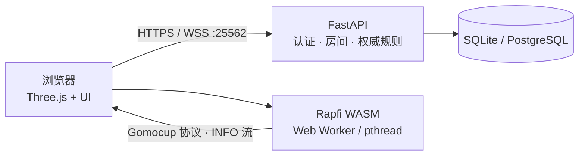

# 弈境 · Yijing Gomoku


一个原创的 **3D 禅意网页五子棋**：木纹棋盘、玻璃质感棋子、柔和光影、程序化音效，支持本地同屏、AI 对弈与好友联机。

前端使用 **Vite + TypeScript + Three.js**；AI 是 **Rapfi 引擎的 WASM 构建**，直接在浏览器里运行（实时思考信息可视化，服务端零引擎进程）；后端使用 **FastAPI** 负责账号、房间、观战与权威规则。

> **开发说明**：本项目完全由 AI 模型 **DeepSeek V4.1 Flash 1017** 完成——包括前端与后端代码、3D 棋境与棋子、UI、音效、测试与文档。

## 目录

- [特性](#特性)
- [技术栈](#技术栈)
- [架构](#架构)
- [目录结构](#目录结构)
- [快速开始](#快速开始)
- [配置](#配置)
- [AI 引擎（Rapfi WASM）](#ai-引擎rapfi-wasm)
- [联机系统](#联机系统)
- [3D 场景](#3d-场景)
- [棋境与商城](#棋境与商城)
- [网络电台](#网络电台)
- [HTTP API](#http-api)
- [WebSocket 协议](#websocket-协议)
- [测试与构建](#测试与构建)
- [Docker](#docker)
- [公网部署](#公网部署)
- [常见问题](#常见问题)
- [版权与许可](#版权与许可)

## 特性

### 对局与规则

- **15 × 15，黑先**；规则可在开局时选择：
  - **无禁手**（默认）：连续五子及以上获胜，满盘平局。
  - **有禁手（连珠）**：黑方三三、四四、长连为禁手，黑棋只有「恰好五连」才算胜；
    白方无禁手，五连及以上获胜。禁手判定采用标准递归定义，服务端与前端各有一套实现。
- 三种模式：**本地同屏**（无需服务器）、**人机对弈**、**好友联机**。
- 游客或注册账号登录；密码使用 **Argon2id** 哈希，会话令牌只存 SHA-256。
- 悔棋（单机撤销一轮；联机为请求 / 确认模型）、认输、重开、最后落子标记、五连高亮。
- 刷新页面或断线后，凭 Cookie 与会话恢复对局。
- 鼠标与触屏落子，响应式桌面 / 手机布局，尊重「减少动态效果」偏好。

### 联机与社交

- **在线大厅**：实时名单，标注「可约战 / 房间等待中 / 对弈中」；订阅式推送。
- **约战**：点击大厅里的棋友发起，对方 30 秒内接受即开局；可撤回，掉线立刻作废。
  发起时可先选定棋境与读秒，对方在弹窗里就能看到，接受即沿用。
- **开局决定先后手**：双方各自表态「希望谁先手」，一致则直接定，不一致则进入
  3D 抛硬币（硬币两面刻着两位玩家的名字），朝上一面先手。揭晓前谁也不能落子。
- **房间**：6 位房间号创建 / 加入，实时同步落子。
- **读秒（每步限时）**：建房 / 约战时可选 `不限时 / 30 / 60 / 120 秒`，**默认不限时**。
  服务端是唯一权威，只在状态变化时下发截止时刻，客户端本地倒计时而**不逐秒广播**；
  双方表态先后手期间不计时，对手断线双方停表、重连从剩余时间继续，超时判负
  （`winReason: timeout`）且只裁决一次。人机局与本地同屏不读秒。
- **观战**：第三人只读地看同一张棋盘，不占座、不写库，结束时留在原地看结果。
- **断线**：对手掉线即亮横幅并倒计时，`RECONNECT_GRACE_SECONDS`（默认 120 秒）内回来可恢复，
  超时自动判负（`winReason: offline`）；双方同时掉线时不计时。
- **铜铃**：摆在棋盘左前角的桌面上，点一下按钮下压、桌上荡开声波，对手的铃声与提示同时到。
  **默认没有冷却**，连续点击（含连点器）会逐次转发给对手；如需限流，把
  `RING_COOLDOWN_SECONDS` 设为正数即可。
- **快捷短语**：操作坞里的预设短语，经 WebSocket 广播给对方并弹出气泡；客户端只发
  `phraseId`，文案由服务端词表下发，从源头杜绝注入。
- **个人名片**：在大厅或对局中点玩家头像 / 昵称即可查看。看自己与看别人都显示战绩 **与积分**，
  布局完全一致（总场次 / 胜率 / 积分 / 胜 / 负 / 和棋六格网格）；积分是公开分数，与段位展示一致，
  仅不暴露钱包的私人部分（已解锁商品 / 装备皮肤）。**战绩只统计联机对局**——人机局的
  对手强度由玩家自己挑，算进胜率没有可比性。

### AI

- **Rapfi WASM**：Gomocup 顶尖引擎编译到浏览器，AI 落子、分析、复盘评估全部在本地完成。
- **实时思考面板**：搜索深度、胜率、评估分与主变化（Rapfi 原生 INFO 流，浏览器本地直读）。
- **手动 AI 分析**（人机 / 本地）：点操作坞「AI分析」，本地引擎直接分析当前局面，
  棋盘亮出绿色提示环。
- **联机 AI 分析**：好友对局中请求分析，对方同意后由请求方的本地引擎计算建议点，
  结果**双方与观战者都可见**（绿色提示环，落子后才收起）。
- **AI 继承皮肤**：AI 使用玩家当前装备的棋子皮肤；设置里的「显示对方玩家装备的棋子皮肤」
  只在 **PVP** 生效。
- 引擎按浏览器能力降级：有跨域隔离时用 pthread 多线程变体，否则退回单线程 SIMD 变体。

### 视觉与音效

- **五种棋境**：基础茶室（默认）、日式庭院、赛博夜局、现代客厅、摄影棚。
- **棋子材质**：默认黑玉 / 白玉；商城另有三种玻璃 / 磨砂材质——
  **墨玉**（磨砂半透明黑）、**鸿璐**（青色透明玻璃）、**凝脂**（半透明白）。
- **程序化音效**：Web Audio 合成，落子音与棋盘涟漪**同一时刻**响起；支持静音。
- **手数编号**：设置里可选「不显示 / 最新一步 / 最新两步 / 全部步数」，黑子配浅字、
  白子配深字，最新一手标红；编号开启时最新一手的提示圆点自动隐藏。
- **落子动画**：自由落体 + 挤压回弹 + 涟漪扩散，音画同步。
- **视角**：右键 / 双指拖动旋转，滚轮 / 捏合缩放，**单击鼠标中键**平滑复位视角，
  「复位视角」按钮同样走缓动过渡。

### 商城与个性化

- **积分**：服务端权威。新用户初始 **10000** 分，每下完一局 **+10**，购买时扣减。
- **商城**：目前出售三种棋子材质（墨玉 / 鸿璐 / 凝脂，各 **30 分**）；**五种棋境全部免费**。
- 已解锁材质可随时装备 / 取消装备，未解锁或未装备的材质绝不渲染。
- 纯客户端偏好（装备哪套材质、显示哪些编号、是否显示对手皮肤）存于本地。

### 复盘

- 已结束的 AI / 联机对局留在服务器，可按「全部 / 已收藏 / 与好友 / 与 AI」分类查看。
- 播放条支持首手 / 上一手 / 播放 / 下一手 / 终局与进度条，标注日期时间与结果，按 Esc 退出。
- 结算卡上可直接「复盘本局」；复盘复用同一套棋盘渲染，落子动画、最后一手标记、
  五连高亮都与实战一致。
- 复盘页的「AI评估」在浏览器本地计算，结果按手缓存，翻回来即时重现。
- **收藏**：播放条上的星标可把一局棋谱收藏下来（列表里每行也有星标可切换），
  收藏的棋局**永久保留**；取消收藏需二次确认，取消后回到 30 天滚动清理的范围
  （不会立刻删除，真正的删除仍由清理任务按时间判断）。
- **一键续弈**：拖到任意一手点「续弈」，把当前局面当残局起点开一局人机继续下。
  执子方当场选（计算机执黑 / 执白），棋境与规则跟着棋谱走。前 N 手记作
  `startPly`——重开回到这里而不是空盘，悔棋也退不过这一线。

## 技术栈

| 层 | 选型 |
| --- | --- |
| 前端 | Vite 7 · TypeScript 5.9 · Three.js 0.180（无其它运行时 UI 框架） |
| 3D | 自研补间引擎、程序化几何与纹理、CC0 HDRI / PBR / 扫描模型 |
| AI | Rapfi（GPL-3.0）Emscripten WASM，Worker / pthread |
| 后端 | FastAPI · Uvicorn · SQLAlchemy 2 · Pydantic Settings |
| 数据 | SQLite（默认）/ PostgreSQL；会话与令牌哈希落库 |
| 认证 | Argon2id 密码哈希 · HttpOnly Cookie 会话 |
| 实时 | 原生 WebSocket（`/ws`），请求幂等 + 个性化快照广播 |
| 测试 | pytest（后端）· Vitest（前端）· Playwright（可视化回归） |

## 架构



关键原则：

1. **引擎跑在浏览器里。** AI 落子、思考可视化、复盘评估全部由前端 WASM 完成，服务端零引擎进程；
   AI 着法经 `game.ai_move` 提交，服务端重新校验轮次与合法性。
2. **服务端是权威。** 回合、坐标、胜负、悔棋都由后端校验；前端只做即时反馈。
3. **无状态分析。** 引擎每次思考都 `START + BOARD` 全量重建，悔棋、重开、复盘天然兼容。
4. **多线程按能力降级。** COOP/COEP 就绪时用 pthread 变体，否则退回单线程 SIMD 变体。
5. **状态落库。** 棋局与每一手都持久化，刷新或后端重启后仍能恢复。
6. **大厅不落库。** 在线名单由连接表算出，约战是 30 秒有效期的内存握手，连接断了就作废。

## 目录结构

```text
.
├─ frontend/
│  ├─ public/
│  │  ├─ hdri/        # HDRI 环境贴图（CC0）
│  │  ├─ models/      # 扫描 GLB 模型（CC0 / 用户提供）
│  │  ├─ textures/    # PBR 贴图（CC0）
│  │  └─ engine/      # 编译好的 Rapfi WASM（rapfi-*.wasm / rapfi.data）
│  ├─ src/
│  │  ├─ game/        # 规则、类型、本地对局状态、复盘与设置
│  │  ├─ engine/      # Rapfi WASM 客户端（能力探测 / Worker / 主线程 pthread）
│  │  ├─ scene/       # 3D 场景（棋盘、棋子、棋境、铜铃、抛硬币）
│  │  ├─ audio/       # Web Audio 音效、网络电台播放器
│  │  ├─ network/     # WebSocket 客户端与重连
│  │  ├─ auth/        # 认证请求与 Cookie 会话
│  │  ├─ shop/        # 积分商城与快捷短语数据层
│  │  ├─ ui/          # 页面骨架、反馈、图标、选择器
│  │  └─ styles/
│  ├─ uitest/         # Playwright 可视化回归脚本
│  └─ vite.config.ts
├─ backend/
│  ├─ app/
│  │  ├─ game.py        # 权威对局、AI 着法校验、悔棋、重开、铜铃与短语中继
│  │  ├─ rules.py       # 规则变体：无禁手 / 连珠（禁手判定）
│  │  ├─ lobby.py       # 在线大厅、座位状态、约战握手
│  │  ├─ spectate.py    # 观战：只读席位，内存登记，断线即退
│  │  ├─ replay.py      # 复盘归档（只读）
│  │  ├─ profile_routes.py # 战绩 / 钱包 / 偏好 / 商城
│  │  ├─ radio.py       # 电台曲库（扫描目录 + 索引 + 时长探测）
│  │  ├─ hub.py         # 多连接管理与个性化快照广播
│  │  ├─ websocket.py   # 消息分发、请求幂等
│  │  ├─ security.py    # Argon2id、会话令牌、限流
│  │  ├─ models.py      # SQLAlchemy 模型
│  │  └─ main.py        # 应用装配、静态托管、端口预检
│  ├─ tests/
│  └─ requirements.txt
├─ tools/             # 引擎构建与素材导入脚本（不含 Rapfi 源码树）
├─ docs/              # 场景优化等技术笔记
├─ deploy/            # Caddyfile / nginx.conf
├─ radio/             # 电台曲库（放自己的音乐，不提交）
├─ Dockerfile         # 前端 + 后端多阶段生产镜像
├─ docker-compose.yml
├─ THIRD_PARTY_NOTICES.md
└─ LICENSE
```

## 快速开始

### 环境要求

- **Node.js 20+**（推荐 22）
- **Python 3.11+**
- 引擎已随仓库放在 `frontend/public/engine/`，无需本地安装任何引擎

### 1. 后端

Windows PowerShell：

```powershell
cd backend
python -m venv .venv
.\.venv\Scripts\Activate.ps1
pip install -r requirements.txt
Copy-Item .env.example .env
uvicorn app.main:app --host 0.0.0.0 --port 8000 --reload
```

Linux / macOS 把激活命令换成 `source .venv/bin/activate` 即可。

### 2. 前端

```bash
cd frontend
npm install
npm run dev
```

打开 <http://localhost:25562>。Vite 会把 `/api` 与 `/ws` 代理到 `127.0.0.1:8000`。

### 3. 生产形态（单端口 25562）

```bash
cd frontend
npm run build

cd ../backend
python -m app.main          # 读取 PORT，默认 25562；启动前会做端口占用预检
```

只要 `frontend/dist/index.html` 存在，后端会自动托管静态文件并支持 SPA 回退。
此时前后端同源，不需要 CORS，浏览器直接访问 <http://localhost:25562>。

## 配置

所有配置来自环境变量 / `backend/.env`（见 `.env.example`）：

| 变量 | 默认值 | 说明 |
| --- | --- | --- |
| `PORT` | `25562` | `python -m app.main` / 容器监听端口 |
| `DATABASE_URL` | `sqlite:///<backend>/data/gomoku.db` | 数据库连接串；生产建议 PostgreSQL |
| `SESSION_TTL_HOURS` | `168` | 登录会话有效期 |
| `RECONNECT_GRACE_SECONDS` | `120` | 断线重连宽限；超时自动判负（`winReason: offline`） |
| `RING_COOLDOWN_SECONDS` | `0` | 铜铃冷却（秒）；`0` = 不限制，允许连按 |
| `CHALLENGE_TTL_SECONDS` | `30` | 大厅约战有效期 |
| `CORS_ORIGINS` | 空 | 仅跨域开发需要，逗号分隔 |
| `COOKIE_SECURE` | `false` | 公网 HTTPS 部署时设为 `true` |
| `COOKIE_NAME` | `zen_session` | 会话 Cookie 名 |
| `TRUST_PROXY` | `false` | 受信反向代理后设为 `true`，启用 `X-Forwarded-For` |
| `FRONTEND_DIST` | 空 | 自定义前端 `dist` 目录 |
| `RADIO_DIR` | 空（用仓库根 `radio/`） | 电台曲库目录；为空或不存在时电台关闭 |

> 规则协商超时固定为 120 秒（`OPENING_TIMEOUT_SECONDS`）；一方不表态时服务端会替他补选并揭晓。
>
> 读秒同样只有四个档位（`不限时 / 30 / 60 / 120 秒`），白名单写在
> `backend/app/game.py` 的 `ALLOWED_PER_MOVE_MS`。**刻意不做成环境变量**：每步限时是产品规则
> （将来按档位做排位统计），不是部署参数；客户端不做白名单外的取值。

## AI 引擎（Rapfi WASM）

引擎为 [Rapfi](https://github.com/dhbloo/rapfi)（**GPL-3.0**）的 Emscripten 构建，按浏览器能力自动选择：

| 变体 | 条件 | 说明 |
| --- | --- | --- |
| `multi-simd128` | 全站 COOP/COEP 头 + WASM SIMD | 主线程实例化，搜索跑在引擎自己的 pthread 里 |
| `single-simd128` | 无跨域隔离但有 SIMD | Worker 包裹，单线程搜索 |

NNUE 权重（mix9svq 无禁手 15 路，约 10MB）随构建打包为 `engine/rapfi.data`，
首次进入人机对局时由浏览器下载，之后走缓存。老浏览器（无 WASM SIMD）会收到友好提示。

**重新构建引擎**：安装 emsdk 后，按 `tools/build_rapfi_wasm.sh` 的说明把
[Rapfi 上游源码](https://github.com/dhbloo/rapfi) 克隆到 `tools/rapfi/`，再运行该脚本。
本仓库**不包含** Rapfi 源码树（体积大且含上游子模块），只提交编译好的 WASM。

检查状态：

```bash
curl http://127.0.0.1:25562/api/health
# {"status":"ok","service":"zen-gomoku-backend","radio":{...},"engine":{"provider":"rapfi-wasm","location":"client"}}
```

### 集成细节

- 命令：`START 15`、`INFO RULE 0`、`INFO SHOW_DETAIL 3`（开启思考信息流）、
  `BOARD x,y,color ... DONE`（全量重建 + 思考）、`YXSTOP`（软停）。
- 坐标转换：本项目 `(row, col)` ↔ Gomocup `(x=col, y=row)`，均为 0 基。
- INFO 流（`INFO DEPTH/EVAL/WINRATE/BESTLINE`）由客户端逐行解析，驱动思考面板与提示环。
- GPL 合规：`frontend/public/engine/*` 是 Rapfi 的编译产物，源码可从上游获取；
  本仓库不含源码树，详见 `THIRD_PARTY_NOTICES.md`。

## 联机系统

### 大厅与约战

大厅是「谁在线、谁有空」的实时视图，它**不落库**：连接断了、进程重启了，握手就作废。

- **名单**：在线来自 WebSocket 连接表；`可约战 / 房间等待中 / 对弈中` 由客户端报告的
  `game.focus`（我此刻在看哪盘棋）决定，而不是「库里有没有没下完的棋」——否则关掉标签页后
  会永远挂在「对弈中」，既不能约战也回不到那盘棋。
- **订阅式推送**：只有打开大厅面板的连接才收名单；重复 `lobby.watch {on:true}` 等价于
  「再给我一份最新的」，客户端用它做 5 秒兜底刷新。
- **约战握手**：`challenge.create` → 对方弹窗 → `CHALLENGE_TTL_SECONDS` 内接受 / 婉拒，
  超时或掉线即作废；发起方可撤回。一次接受会让双方其它待回应约战立即失效。
- 正在对局中的人被约战时自动回绝并提示，不会被弹窗打断。

### 开局决定先后手

联机对局不再随机指定黑白，先后手交还给两位玩家：

1. **各自表态**：每局开始前双方独立选择「希望谁先手」；选择期间谁也不能落子
   （服务端 `OPENING_PENDING` 兜底）。双方都能看到「对方是否已选」，但只有都表态后才揭晓。
2. **一致则直接定**：两人指向同一位玩家，该玩家先手，界面显示「双方一致 · XX 先手」。
3. **不一致则抛硬币**：进入 3D 抛硬币环节，硬币两面刻着两位玩家的名字，朝上一面先手；
   尊重「减少动态效果」。
4. **揭晓**：先手者执黑（座位自动交换），经 `game.opening_result` 推给双方与观战者。

边界：一方 120 秒不表态，服务端随机补选并揭晓；AI 对局与本地同屏沿用传统「黑先」。

### 观战、断线与铜铃

- **观战只读**：不占座、不写库，快照里 `yourColor` 为 `null`，服务端拒绝其落子 / 悔棋 / 重开；
  结束时留在原地看结果，但没有「再来一局」。
- **断线有两分钟的账**：一方断开后另一边立刻收到 `game.presence` 并开始走秒；
  宽限内回来恢复，超时判负。提示与裁决共用同一个起点，双方不会各说各话。
- **铜铃**：不改变棋局状态，不加锁、不落库。前端**不拦截连按**，每次点击都在本地播放下压
  与声波动画，并各发一次 `game.ring`；服务端默认**不限制**转发频率（`RING_COOLDOWN_SECONDS=0`），
  连按 / 连点器都会逐次送达。把该值设为正数即可恢复冷却，冷却中的按铃回 `accepted:false` 但不报错。

观战与掉线共用同一份快照字段：

| 字段 | 含义 |
| --- | --- |
| `spectating` | 我是来看棋的（没有颜色，不能落子） |
| `spectatorCount` | 含自己在内的旁观人数 |
| `presence` | `{black: 剩余毫秒, white: 剩余毫秒}`，0 表示在线；只在进行中的联机对局里非空 |

### 读秒（每步限时）

一局棋只在**建房 / 约战**时定一次读秒档位，中场不能改——和棋境、规则同一层级。

| 时机 | 行为 |
| --- | --- |
| 刚开局、先后手未揭晓（`OPENING_PENDING`） | **不启动**。此刻扣时会冤枉还没分到黑白的人 |
| 先后手揭晓 | 先手方起表 |
| 落子成功 | 己方停、对方起，各自重置为完整预算（没有累计、没有加秒） |
| 悔棋成功 | 重置给「当前该走的一方」，不退还之前消耗的时间 |
| 重开 | 双方重置为完整预算 |
| 认输 | 停表，`winReason: resign`，不进超时逻辑 |
| **对手断线** | **双方停表**并保留剩余；`presence` 的 120 秒宽限照旧走 |
| 对手重连 | 从剩余时间继续，不从头开始 |
| 走到 0 | 服务端裁定 `winReason: timeout`，只裁决一次 |
| 服务端重启 | 恢复进行中的限时局，用落库的截止时刻续算，不无故判负 |

设计要点：

- **时基是墙钟**（`time.time()`），不是 `time.monotonic()`：前者能跨进程重启存活，
  后者只在单次运行内单调。截止时刻按 `turn_started_at + per_move_ms` 派生，
  **从不做「剩余 -= 1」的累减**——累减会把每次调度误差攒进结果里。
- **不为每一手起一个轮询循环**：每局最多一个「睡到截止时刻」的 `asyncio` 任务，
  判得准最后一秒，也不随对局数线性上涨。
- **落子与超时抢同一个锁**：`game.move` 进锁后先判时钟，已过期就当场判负并回
  `CLOCK_EXPIRED`，不再落子；`requestId` 幂等照旧，同一次落子重发不会重复裁决。
- **前端拿到 `CLOCK_EXPIRED` 不弹红字**：玩家那一刻该看到的是「我输了」，
  不是「操作失败」。终局快照紧随其后，界面以快照为准。

## 3D 场景

渲染层拆成三个互不依赖的模块，由一个薄门面串起来。**所有胜负判断与合法性校验都在
`game/rules.ts` 与服务端 `app/rules.py`，场景层只负责把算好的棋盘画出来**，改视觉不影响规则。

```text
frontend/src/scene/
├─ GomokuScene.ts       门面：指针事件、快照翻译、棋境装配
├─ SceneManager.ts      渲染器 / 相机 / OrbitControls / 后处理 / 补间队列 / 主循环
├─ BoardManager.ts      棋盘、棋子、预览、标记、落子动画、射线拾取、提示环
├─ stoneMaterials.ts    棋子材质目录 + 工厂（实体 / 磨砂 / 玻璃 / 青色玻璃）
├─ materials.ts         程序化兜底纹理（棋盘木纹 / 棋子光晕）+ 棋境辅助贴图
├─ assets.ts            CC0 素材加载（HDRI / PBR / glTF，含 Meshopt 解码）
├─ Bell.ts              桌面铜铃
├─ CoinScene.ts         开局抛硬币
├─ config.ts            棋盘常量、相机机位、配色、坐标换算
├─ environments/        五种棋境的装配（共用 Environment 基类）
└─ animation/tween.ts   自研 rAF 补间引擎（缓动函数 + 队列）
```

**为什么不用 gsap**：落子只需要「一段位移 + 一段缩放回弹」，自研约 100 行即可覆盖，
既省掉运行时依赖，也能把缓动函数抽成纯函数做单元测试。

**界面布局**：3D 场景铺满视口，页面本身不滚动；顶栏、叙事行、状态胶囊与操作坞都是
浮在场景上的玻璃薄片。首页通过 `#app.is-playing` 把对局 HUD 淡出并切换顶栏文字颜色。

### 相机与操作

| 操作 | 效果 |
| --- | --- |
| 左键点击 | 落子（拖拽被忽略，不会误放棋子） |
| 左键拖动 / 触屏单指 | 旋转视角 |
| 右键拖动 / 触屏双指 | 旋转 + 缩放 |
| 滚轮 / 双指捏合 | 缩放 |
| 单击中键 | 平滑复位视角（中键拖拽不触发，避免与浏览器自动滚动冲突） |

极角限制在 `0.02 ~ 1.05 rad`：下限不为 0 是因为视线与 up 向量平行时 `lookAt` 会退化；
上限保证相机不会沉到桌面以下。方位角完全放开，房间四面墙与天花都做齐，可 360° 环绕。

**取景是算出来的，不是写死的**：`SceneManager` 把棋盘八个角投影到 NDC，迭代调整相机距离，
直到包围盒填满「视口减去 HUD 占位」的安全区，再用 `setViewOffset` 做纵向补偿；竖屏另有一套
更俯视的机位。

### 五种棋境

一局棋在哪个房间下，由 `scene` 字段决定：`tea / courtyard / cyber / living / studio`。
五种棋境共用同一套渲染层，只在「材质与陈设」上不同；真实感来自三类 CC0 素材
（下载自 Poly Haven，见 `THIRD_PARTY_NOTICES.md` 与 `docs/SCENE_OPTIMIZATION.md`）：
**HDRI 环境光与背景、PBR 材质贴图、扫描模型**。

- **基础茶室**（默认）：榻榻米、杉木梁柱、红木桌面、古民家 HDRI、真实扫描茶具。
- **日式庭院**：`chinese_garden` HDRI 作天空与天光；枯山水白砂、真实岩石、松枫。
- **赛博夜局**：`shanghai_bund` 外滩夜景 HDRI；金属网格地面、霓虹灯牌、飘落花瓣；
  **仅此棋境开启 `UnrealBloom` 后处理**。
- **现代客厅**：整间导入的真实户型（非 CC0，由 `tools/import_cg_gltf.py` 裁剪合成），
  棋盘按真实比例落在茶几上。
- **摄影棚**：360° 无缝弧形背景 + 柔光箱面光，专为截图准备；暗胡桃木台面。

素材随项目分发，运行时不访问外网。贴图与模型**异步加载后热替换**：房间先以纯色建好，
素材到位再挂上去，用户不会白屏等待。

### 渲染要点

- **HDRI** 经 `PMREMGenerator` 预滤波后挂到 `scene.environment`，同时可作 `scene.background`。
  这是整套场景真实感的最大来源。
- **光照**：HDRI 打底 + 日光平行光 + 半球光 + 棋盘聚光灯；`PCFSoftShadowMap`，2048²。
- **格线是有厚度的几何片，不是 `LineSegments`**：WebGL 的 `lineWidth` 恒为 1 像素，
  拉近后细如发丝且会 z-fighting；薄矩形随缩放变化，也不闪。
- **模型用 GLB 而非分体 glTF**：避免 `.bin` 二次请求静默失败；加载走 `fetch + parseAsync`，
  出错时有明确异常可查。
- **限帧与省电**：有运动 60fps，静止 30fps；静止时关掉 `shadowMap.autoUpdate`。
- **落子动画**：棋子上方 5 单位处 300ms 自由落体（位移 ∝ t²），落地瞬间挤压到 0.8 / 1.2
  并在 100ms 内回弹，同时做一次微小二次起跳与涟漪扩散；系统「减少动态效果」时整段跳过。
- **音画同步**：落子音不在快照到达时立刻响，而是等棋子落定、涟漪出现的那一刻才播放。

## 棋境与商城

- 五种棋境**全部免费**，开局时都可手选，也可交给「随机」。
- 商城目前只出售棋子材质，三种各 **30 分**：

| 商品 | 材质 id | 作用方 | 说明 |
| --- | --- | --- | --- |
| 墨玉 | `frosted-black` | 黑 | 磨砂半透明黑子，朦胧玻璃质感 |
| 鸿璐 | `frosted-cyan` | 黑 | 青色透明玻璃，清透如琉璃 |
| 凝脂 | `translucent-white` | 白 | 半透明白子，光线在其间流转 |

- **积分**：新用户 10000，每局 +10，购买时服务端扣减；本地只缓存，换设备跟随账号。
- 装备材质后立即生效；再次点击已装备的材质会取消装备、回退默认实体棋子。

## 网络电台

一台发射机，而不是一个播放器：服务器持有一条排期，「现在放到第几首、第几秒」由
「现在几点」算出来。**所有人听到的是同一首歌的同一个位置**，晚进来的人从中途切进去，
就像调频收音机。界面只给「静音」和「音量」两个控制。

- **放歌**：把 mp3 / m4a / aac / ogg / opus / flac / wav 放进仓库根下的 `radio/`，
  也可以直接指向已有音乐库：`RADIO_DIR=D://Music`。
- **曲名**优先读 ID3 的 `TIT2` / `TPE1`，读不到才退回文件名。
- **时长**单独解析：mp3 常量码率按字节数估算，VBR 读 Xing 头；wav 读 `fmt`/`data`；
  flac 读 `STREAMINFO`；ogg/opus 读末页 granule；其它格式按 192kbps 估算。
- **同步**：加入时先问一次 `/api/radio/state` 拿锚点，之后只看本机单调时钟；每 30 秒对表，
  偏差超过 2.5 秒才纠正。刻意不比较两台机器的绝对时间。
- **目录为空时入口不出现**，不会留一个点了没反应的按钮；新增文件最多 8 秒生效。
- **起播要你自己点**：浏览器不允许无手势播放，点右上角电台按钮才会接上，来下棋的人
  不会被背景音乐突袭。
- **音量是感知曲线**：滑杆位置取平方作为增益，低位才有细调余地。

接口见下表「电台」。

## HTTP API

除特别说明外均使用同一张会话 Cookie：

| 方法 | 路径 | 说明 |
| --- | --- | --- |
| `GET` | `/api/health` | 健康检查：电台曲目数、引擎 provider |
| `POST` | `/api/auth/register` | 注册 |
| `POST` | `/api/auth/login` | 登录 |
| `POST` | `/api/auth/guest` | 创建游客会话 |
| `POST` | `/api/auth/logout` | 退出登录 |
| `GET` | `/api/auth/me` | 当前会话用户 |
| `GET` | `/api/users/me/stats` | 我的战绩（含积分） |
| `GET` | `/api/users/{id}/stats` | 他人战绩与积分（含积分，公开分数；未知用户 404） |
| `GET` | `/api/users/me/wallet` | 我的积分与已解锁列表 |
| `GET`/`PUT` | `/api/users/me/preferences` | 服务器端偏好（编号等设置的跨设备同步） |
| `POST` | `/api/shop/purchase` | 用积分购买商品 `{item_id}` |
| `POST` | `/api/shop/equip` | 装备材质 `{material_black, material_white}` |
| `GET` | `/api/games/replays?limit&offset&mode=ai\|online&favorite` | 我参与过的已结束棋局（`favorite=true` 只看收藏） |
| `GET` | `/api/games/replays/{gameId}` | 单局棋谱（摘要 + 着法序列） |
| `POST` | `/api/games/replays/{gameId}/keep` | 收藏某盘复盘（永久保留） |
| `DELETE` | `/api/games/replays/{gameId}/keep` | 取消收藏（回到 30 天滚动清理） |
| `GET` | `/api/radio` | 电排期 + 曲库 |
| `GET` | `/api/radio/state` | 当前曲目与位置（客户端校准用） |
| `GET` | `/api/radio/{id}` | 音频字节流，支持 `Range`（206） |

复盘只有**参与者本人**能读：别人的棋局一律返回 404（而不是 403，避免暴露「这盘棋存在」）。

## WebSocket 协议

连接：`/ws`，使用登录 Cookie。所有消息为 JSON：

```json
{ "type": "game.move", "requestId": "uuid", "payload": { "gameId": "...", "row": 7, "col": 7 } }
```

`requestId` 用于幂等：同一用户重复发送相同 `requestId` 不会重复落子，直接返回缓存响应。

**服务端 → 客户端**

| 类型 | 说明 |
| --- | --- |
| `session.ready` | 连接成功，携带用户与可恢复棋局 |
| `lobby.players` | 在线名单，只推给已订阅大厅的连接 |
| `challenge.incoming` | 收到约战 `{challengeId, from, expiresInMs, timeControl, scene}`；`scene` 为 `null` 表示随机 |
| `challenge.sent` / `challenge.result` | 约战已发出 / 结果 `{status, gameId?, reason?, byMe?}` |
| `game.snapshot` | 个性化完整快照，客户端以此为准；含 `timeControl` 与 `clock`（见下） |
| `game.undo_requested` / `game.restart_requested` | 对方请求悔棋 / 重开 |
| `game.presence` | 某人上线 / 断线 `{userId, name, color, online, reconnectInMs}` |
| `game.ring` / `game.ring_ack` | 对方按铃 / 按铃回执 `{accepted, cooldownMs}` |
| `game.phrase` / `game.phrase_ack` | 对方快捷短语 / 短语回执 |
| `game.ai_analysis_requested` | 对手请求 AI 分析，被请求方弹窗决定 |
| `game.ai_analysis_result` | 分析结果 `{accepted, byName}`；同意后由请求方引擎计算，双方与观战者可见 |
| `game.ai_request_ack` / `game.ai_response_ack` / `game.ai_result_ack` | 对应请求的回执 |
| `game.first_move_choice_ack` | 「希望谁先手」提交回执 |
| `game.opening_result` | 先后手揭晓 `{firstSeat, method: "agreement"\|"coin", seats}` |
| `spectate.left` | 退出观战 |
| `error` / `pong` | 错误 `{code, message}` / 心跳回应 |

**客户端 → 服务端**

| 类型 | 说明 |
| --- | --- |
| `ping` / `lobby.watch` / `game.focus` | 心跳 / 订阅大厅 / 报告正在看的棋局 |
| `challenge.create` / `challenge.respond` / `challenge.cancel` | 发起（可带 `scene` / `timeControl`）/ 接受婉拒 / 撤回约战 |
| `ai.create` | 开人机局 `{color, scene?, rule?, preset?}`（人机局不读秒）；`preset` 是残局前缀 `[{row, col}, …]`，颜色由服务端按手数推导 |
| `room.create` / `room.join` / `room.resume` / `room.leave` | 房间操作；`room.create` 可带 `timeControl` |
| `game.move` / `game.undo` / `game.undo_response` | 落子 / 悔棋 / 悔棋回应 |
| `game.restart` / `game.restart_response` / `game.resign` | 重开 / 重开回应 / 认输 |
| `game.ai_config` | 编辑模式下切换哪一方由 AI 执子 `{aiBlack, aiWhite}` |
| `game.ai_move` | 提交前端引擎代算的 AI 着法 `{gameId, row, col}`；服务端校验后落子并广播 |
| `game.first_move_choice` | 提交「希望谁先手」`{choice: "self"\|"opponent"}` |
| `game.ring` | 按铃 `{gameId}` |
| `game.phrase` | 发送预设短语 `{gameId, phraseId}`（只有 ID，文案由服务端补齐） |
| `game.ai_request` / `game.ai_respond` / `game.ai_result` | 请求分析 / 回应 / 提交建议点 |
| `spectate.join` / `spectate.leave` | 进入 / 退出观战 |

**棋境相关字段**

`room.create` / `challenge.create` 的载荷都可带棋境：

```json
{ "scene": "tea" | "courtyard" | "cyber" | "living" | "studio" }
```

不写 = 服务端开局时抽签；写了不认识的取值退回到默认棋境 `tea`，**不报错**
——背景不同没有理由把一场约战打成 500。`challenge.incoming` 会把发起方选的
棋境回传给被约战方（`null` 表示随机），让对方在接受前就知道在哪片场景里下。

**读秒相关字段**

`room.create` / `challenge.create` 的载荷可带（缺省 = 不限时，其余取值一律
`VALIDATION_ERROR`）：

```json
{ "timeControl": { "mode": "perMove", "perMoveMs": 30000 } }
```

`game.snapshot` 里新增两块：

```jsonc
{
  "timeControl": { "mode": "none" | "perMove", "perMoveMs": 30000 | 60000 | 120000 | null },
  "clock": {
    "side": "black" | "white" | null,  // 当前该谁走
    "deadlineAt": 1730000000000,       // 截止时刻（epoch 毫秒）；客户端据此本地倒计时
    "remainingMs": 28123,              // 下发那一刻的剩余；用来校正本机与服务端的钟差
    "paused": false                    // 对手断线时为 true：表停着，别让数字骗人
  }
}
```

`clock` 为 `null`（不限时 / 未开局 / 已终局）；`paused` 为 `true` 时前端把数字压暗。

> `remainingMs` 不只是首帧兜底：`deadlineAt - remainingMs` 就是服务端眼中的「此刻」，
> 客户端拿它与本机时间相减得到钟差，之后每一跳都在校正后的时间轴上重算。
> 玩家电脑的钟快慢几分钟很常见，少了这一步，屏幕上的秒数会整体偏掉。

新增终局原因 `winReason: "timeout"`（思考超时），新增错误码 `CLOCK_EXPIRED`
（落子在截止后到达，服务端已判负并拒绝该手）。

> 刻意**不**每秒广播快照：个性化快照的成本随在线人数线性增长。客户端拿
> `deadlineAt` 自己算，服务端只在状态变化时下发。

**残局续弈相关字段**

快照新增 `startPly`（本局从第几手开始，正常开局为 `0`）。`ai.create` 的 `preset`
会校验坐标范围 / 重复落点 / 棋盘容量 / 是否已经五连，任何一条不满足都回
`VALIDATION_ERROR`；颜色由服务端按手数奇偶推导，客户端送什么颜色都不作数。

> 接力这条语义贯穿四处：`startPly` 之前的手悔棋撤不掉；重开清回 `startPly` 而
> 不是空盘；结算卡只报本局下的手数；**人机局一律不进战绩统计**（`mode == "ai"`
> 在 `/api/users/{id}/stats` 里被整体排除，积分仍按 `POINTS_PER_GAME` 照发）。

## 测试与构建

```bash
# 后端：规则（含连珠禁手）、认证、AI 着法、联机、观战、复盘、读秒、电台
cd backend
python -m pytest

# 前端：规则、状态、设置、复盘、皮肤、音效、补间、读秒等单测
cd frontend
npm test

# 前端类型检查 + 生产构建
npm run build
```

当前基线：后端 **141 项**、前端 **114 项**单测通过。
`frontend/uitest/` 下另有 Playwright 可视化回归脚本（鸿璐配色、商城、名片、提示环等）。

## Docker

```bash
cp .env.example .env
docker compose up -d --build
```

访问 <http://localhost:25562>。Compose 会把 SQLite 数据持久化到 `./data`，把
`${RADIO_DIR_HOST:-./radio}` 只读挂到 `/radio`。

**AI 与 Docker**：引擎跑在浏览器端，镜像无需任何引擎二进制或 Wine——前端打包的
`public/engine/*` 会随镜像一起提供，容器只承载账号、房间与权威规则。

## 公网部署

### 直接暴露

1. 路由器把公网 TCP `25562` 转发到服务器内网 IP 的 `25562`。
2. 防火墙放行 TCP `25562`。
3. 启动 `docker compose up -d` 或原生后端。
4. 访问 `http://公网IP:25562`。

这种方式是 **HTTP 明文**，登录密码与 Cookie 可能被窃听，只建议临时测试。若坚持直接暴露，
保持 `COOKIE_SECURE=false`，否则浏览器不会回传 Cookie。

**Windows 主机原生运行**：

```powershell
cd frontend; npm run build; cd ..\backend
python -m app.main          # 读 backend\.env，监听 0.0.0.0:25562
```

放行入站端口：

```powershell
New-NetFirewallRule -DisplayName "Yijing Gomoku 25562" -Direction Inbound -Protocol TCP -LocalPort 25562 -Action Allow
```

开机自启可用 `nssm install yijing-gomoku` 把 `python -m app.main` 注册为服务，工作目录设为 `backend`。

### 推荐：域名 + HTTPS

1. 域名 A 记录指向公网 IP。
2. 用 Caddy 反代本机 `25562`（参考 `deploy/Caddyfile`）：

```caddyfile
gomoku.example.com {
    encode zstd gzip
    reverse_proxy 127.0.0.1:25562
}
```

3. 设置 `COOKIE_SECURE=true`、`TRUST_PROXY=true` 并重启后端。
4. Nginx 方案见 `deploy/nginx.conf`，已包含 WebSocket `Upgrade` 配置。

Caddy / Nginx 需要 80/443 端口签发证书；若无法开放，可用 Cloudflare Tunnel 等隧道方案终止 TLS。

### 安全检查清单

- [ ] 公网只暴露反向代理端口，不暴露数据库
- [ ] 生产使用 HTTPS，并设置 `COOKIE_SECURE=true`
- [ ] 不要把 `.env`、`data/`、`radio/` 提交到 Git
- [ ] 定期备份 `data/gomoku.db`
- [ ] 多实例部署前改用 PostgreSQL，并把房间 / 会话改为共享存储

## 常见问题

**用 HTTP 打开时某些浏览器 API 不可用**

非安全上下文会隐藏 `crypto.randomUUID`、`navigator.clipboard` 等 API。前端已对这两处做降级
（UUID 用 `getRandomValues` 拼装，复制回退到 `execCommand`），明文 HTTP 下也能正常落子与复制
房间号。但 HTTPS 仍是推荐做法——它同时解决密码明文传输问题。

**看不到电台按钮**

依次确认：`/api/health` 里 `radio.tracks` 是否为 0；`RADIO_DIR`（不填则是仓库根 `radio/`）
是否存在、里面是否有音频文件。`tracks` 为 0 时入口会被整个隐藏——这是刻意的。

**电台没声音，但按钮在跳**

浏览器自动播放策略要求先有一次用户交互，播放器在「待命」状态。点一下页面任意处即可；
若仍无声，检查卡片里的静音状态与本机音量。

**对手掉线了会怎样**

界面会亮出「已断线，超时将判负」的横幅并开始走秒。`RECONNECT_GRACE_SECONDS`（默认 120 秒）
内对方重连，横幅自动收起；超时判你获胜。双方同时掉线时不计时，谁先回来谁接着下。

**点了桌上的铜铃，对方没反应**

铃只在对局进行中、并且对面在线时才会传过去。默认**没有冷却**，连按会逐次送达；
如果对面已经断线，用横幅等他就好——铃叫不回一个关掉的浏览器。

**大厅里有人一直显示「对弈中」，约不了战**

三种可能：他真的在看某个棋盘（客户端会持续报告 `game.focus`）；他停在房间等待页；
或者他的连接还没被服务端判定为断开。前两种是真实占座，第三种会在 TCP 超时后自动消失。

**25562 被占用**

```powershell
netstat -ano | findstr :25562
```

```bash
ss -ltnp | grep 25562
```

停止占用进程，或临时换端口并在 Vite / Compose 中同步修改。

**AI 引擎加载不出来**

检查浏览器控制台与 `/api/health`（`engine.provider` 应为 `rapfi-wasm`）；首次进入人机对局
需要下载约 10MB 权重，网络受阻会表现为「正在加载本地引擎」长时间不消失。响应头需要
`Cross-Origin-Opener-Policy` / `Cross-Origin-Embedder-Policy` 才能启用多线程变体。

**刷新后没有恢复**

确认浏览器允许 Cookie；恢复依赖同一会话 Cookie。游客清除站点数据后无法找回原身份。

**反向代理后 WebSocket 断线**

确认代理转发了 `Upgrade` 和 `Connection` 头，并提高读超时。参考 `deploy/nginx.conf`。

## 版权与许可

本项目原创代码与视觉以 **MIT License** 发布，详见 [LICENSE](LICENSE)。第三方依赖与素材的授权见
[THIRD_PARTY_NOTICES.md](THIRD_PARTY_NOTICES.md)。

Rapfi WASM 引擎（**GPL-3.0**）随仓库分发于 `frontend/public/engine/`；其对应源码来自上游
[Rapfi](https://github.com/dhbloo/rapfi)。本仓库不包含 Rapfi 源码树，重新构建请按
`tools/build_rapfi_wasm.sh` 的说明将上游源码放入 `tools/rapfi/` 后再构建。
